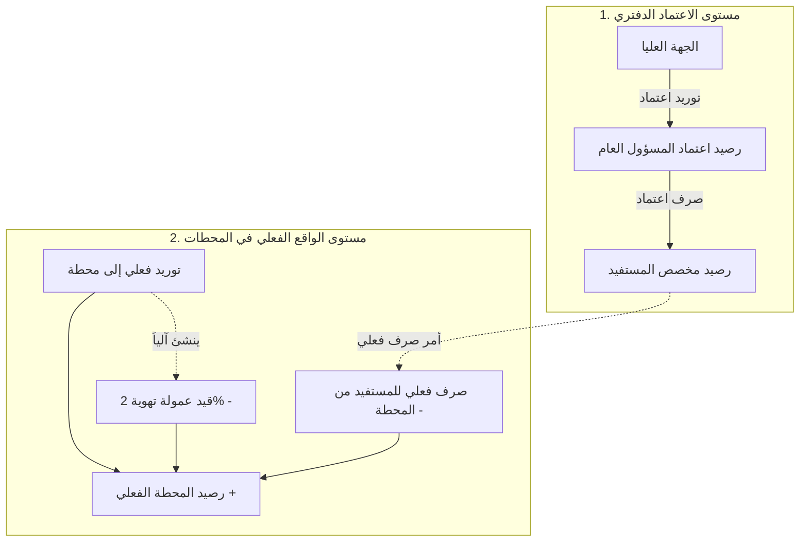

# وثيقة متطلبات ومواصفات النظام (SRS)
## نظام إدارة ومحاسبة مخصصات المحروقات (Fuel Allocation Accounting System)

---

### 1. نظرة عامة ونطاق النظام (Project Overview & Scope)
* **طبيعة النظام:** نظام محاسبي عيني/كمي متخصص في تتبع وإدارة كميات المشتقات النفطية والوقود (بترول، ديزل، إلخ) بوحدات الحجم (اللتر، الدبة، البرميل)، وهو **نظام غير مالي** (لا يتعامل بالعملات والأسعار مباشرة).
* **المستخدم الأساسي:** مسؤول الإمداد والوقود (معتمد المحروقات) في الوحدة أو المنشأة، وهو المسؤول عن استلام الاعتمادات وتوزيعها على المستفيدين والتنسيق مع المحطات.
* **الهدف:** ضبط ومطابقة حركة الوقود بين ما يتم اعتماده دفترياً، وما يتم ضخه وتوريده فعلياً للمحطات، وما يصرف للمستفيدين عبر أوامر صرف موثقة.

---

### 2. أطراف النظام والكيانات (System Actors & Entities)
يتعامل النظام مع أربعة أطراف رئيسية:
1. **الجهة العليا (الموردون - الدائرة / الشركة / القيادة):** الجهة المانحة التي تخصص الاعتماد الدوري للوقود.
2. **المسؤول (مدير الإمداد - صاحب التطبيق):** من يدير التطبيق، ويسجل القيود، ويصدر أوامر الصرف.
3. **المستفيدون (العملاء - الحسابات التابعة):** الأفراد أو الجهات التابعة للمسؤول والمستحقة لحصص وقود (مثل: أحمد سيف، خالد علي).
4. **محطات الوقود (Stations):** المحطات الفعلية التي يتم إيداع الوقود فيها ويصرف المستفيدون حصصهم منها.

---

### 3. بنية قاعدة البيانات المقترحة (Database Schema)
بناءً على التوجيهات المعمارية، يتكون النظام من الجداول الأساسية التالية:

#### 3.1. جدول الحسابات (`Accounts`)
جدول موحد يجمع الموردين والعملاء معاً:
* `id`: المعرف الفريد.
* `name`: اسم الحساب (اسم الجهة العليا أو اسم المستفيد).
* `account_type`: نوع الحساب (`SUPPLIER` للموردين/الجهة العليا، `BENEFICIARY` للمستفيدين/العملاء).
* `phone_number`: رقم الهاتف (لإرسال الرسائل والإشعارات).
* `is_active`: حالة الحساب (نشط / معطل).
* `created_at`: تاريخ الإنشاء.

#### 3.2. جدول المحطات (`Stations`)
* `id`: المعرف الفريد.
* `name`: اسم المحطة (مثل: محطة تعز، محطة صنعاء).
* `location`: موقع المحطة أو المدينة.
* `phone_number`: هاتف المسؤول في المحطة (لاستلام رسائل أوامر الصرف).
* `default_commission_rate`: النسبة الافتراضية لعمولة التهوية (مثلاً 2%).
* `is_active`: حالة المحطة.

#### 3.3. جدول الوحدات والتحويلات (`Units`)
يدعم مرونة إدخال الكميات بوحدات متعددة، مع ربطها بوحدة الأساس المعيارية (**اللتر**):
* `id`: المعرف الفريد.
* `name`: اسم الوحدة (لتر، دبة، برميل).
* `conversion_factor`: معامل التحويل إلى لتر:
  * **لتر:** 1
  * **دبة:** 20
  * **برميل:** 200 (أو 10 دباب)
* `is_base_unit`: هل هي الوحدة الأساسية (نعم للتر).

#### 3.4. جدول أنواع العمليات (`TransactionTypes`)
ثوابت النظام للعمليات الخمس:
* `1`: توريد اعتماد (Inflow Quota)
* `2`: توريد فعلي (Inflow Actual)
* `3`: عمولة تهوية (Ventilation Commission - مرتبطة بالتوريد الفعلي)
* `4`: صرف اعتماد (Allocation Quota)
* `5`: صرف فعلي (Outflow Actual)

#### 3.5. جدول العمليات والقيود (`Transactions`)
الجدول المحاسبي المركزي لتسجيل كافة الحركات:
* `id`: رقم القيد/العملية.
* `transaction_number`: رقم تسلسلي فريد لأمر الصرف/التوريد.
* `transaction_date`: تاريخ ووقت العملية.
* `type_id`: نوع العملية (مرتبط بجدول أنواع العمليات).
* `account_id`: الحساب المرتبط (الجهة العليا أو المستفيد).
* `fuel_type`: نوع المحروقات (بترول، ديزل، إلخ).
* `unit_id`: الوحدة المستخدمة عند الإدخال (لتر، دبة، برميل).
* `entered_quantity`: الكمية المدخلة بالوحدة المختارة.
* `base_quantity_liters`: الكمية المحسوبة والمعادلة باللتر (للحسابات الموحدة).
* `station_id`: المحطة المنفذة للعملية.
* `reference_station_id`: مرجع المحطة (المحطة التي يُخصم منها حسابياً في حال اختلف مكان الصرف).
* `parent_transaction_id`: رقم العملية المرتبطة (خاص بقيد عمولة التهوية لربطه بقيد التوريد الفعلي التابع له).
* `notes`: ملاحظات وبيان العملية.

---

### 4. دورة العمليات والقيود المحاسبية (Accounting Workflow)



#### تفصيل العمليات:
1. **توريد اعتماد (Inflow Quota):**
   * إثبات اعتماد كمية وقود من الجهة العليا للمسؤول لشهر معين.
   * الأثر: زيادة الرصيد الدفتري العام للمسؤول.
2. **توريد فعلي (Inflow Actual):**
   * إثبات وصول كمية وقود فعلية وضخها في خزان محطة محددة.
   * الأثر: زيادة الرصيد الفعلي للمحطة بالكمية الإجمالية.
3. **عمولة تهوية (Ventilation Commission):**
   * قيد منفصل ينشأ تلقائياً مرتبطاً بقيد التوريد الفعلي عبر `parent_transaction_id`.
   * الأثر: خصم نسبة عمولة التهوية (مثل 2%) من رصيد المحطة، لتسجيل الصافي المتاح بدقة وإظهار عمولة التهوية في كشف الحساب.
4. **صرف اعتماد (Allocation Quota):**
   * تحديد الحصة الشهرية المستحقة للمستفيد من رصيد الاعتماد العام.
   * الأثر: تحديد سقف الصرف للمستفيد.
5. **صرف فعلي (Outflow Actual):**
   * إصدار أمر صرف للمستفيد لاستلام كمية وقود من محطة محددة.
   * تحديد (المحطة المنفذة) و (مرجع المحطة المخصوم منها حسابياً إذا كان الصرف بمقاصة).
   * الأثر: خصم الكمية من الحصة المتاحة للمستفيد + خصم الكمية من الرصيد الفعلي للمحطة المرجعية.

---

### 5. المعادلات المحاسبية ومؤشرات الأرصدة (Balances & Formulas)

1. **رصيد المحطة الفعلي المتاح:**
   $$\text{رصيد المحطة} = \sum (\text{التوريد الفعلي}) - \sum (\text{عمولات التهوية}) - \sum (\text{الصرف الفعلي المخصوم من المحطة})$$

2. **فارق التوريد (عجز/متبقي لدى الجهة العليا):**
   $$\text{متبقي التوريد لم يصل المحطات} = \sum (\text{توريد الاعتماد}) - \sum (\text{التوريد الفعلي})$$

3. **حساب المستفيد:**
   * **إجمالي المعتمد له:** $\sum (\text{صرف الاعتماد})$
   * **إجمالي المنصرف له فعلياً:** $\sum (\text{الصرف الفعلي})$
   * **المتبقي للمستفيد:** $\text{إجمالي المعتمد له} - \text{إجمالي المنصرف الفعلي له}$

---

### 6. نظام قوالب الرسائل النصية (SMS Notification Templates)

عند حفظ عملية **"صرف فعلي"** بنجاح، يتيح التطبيق إرسال رسالتين بنقرة زر واحدة عبر قوالب مهيأة مسبقاً:

#### أ. قالب رسالة المحطة (أمر الصرف):
```text
أمر صرف وقود
المحطة: {اسم_المحطة}
مرجع الخصم: {مرجع_المحطة}
المستفيد: {اسم_المستفيد}
الكمية: {الكمية} {الوحدة} ({الكمية_باللتر} لتر)
نوع الوقود: {نوع_الوقود}
رقم العملية: #{رقم_العملية}
التاريخ: {التاريخ_والوقت}
يرجى التزويد بموجب هذا الأمر.
```

#### ب. قالب رسالة المستفيد (إشعار بالصرف والرصيد):
```text
إشعار صرف وقود
الأخ: {اسم_المستفيد}
تم إصدار أمر صرف لكمية: {الكمية} {الوحدة} ({نوع_الوقود})
من محطة: {اسم_المحطة}
رقم العملية: #{رقم_العملية}
---
رصيدك المعتمد: {إجمالي_المعتمد} لتر
إجمالي ما صرفته: {إجمالي_المصروف} لتر
رصيدك المتبقي الحالي: {الرصيد_المتبقي} لتر
```

---

### 7. المتطلبات غير الوظيفية (Non-Functional Requirements)
1. **العمل بدون اتصال (Offline First):** تخزين محلي كامل لقاعدة البيانات في جهاز المستخدم لضمان سرعة العمل في أي مكان دون الحاجة للإنترنت.
2. **سلامة الحركات والقيود (Data Integrity):** الربط المحكم بين التوريد وعمولته، ومنع تجاوز الصرف الفعلي للرصيد المتاح إلا بتحذير وتأكيد من المسؤول.
3. **النسخ الاحتياطي والاستعادة:** إمكانية أخذ نسخة احتياطية من قاعدة البيانات واستعادتها بسهولة.
